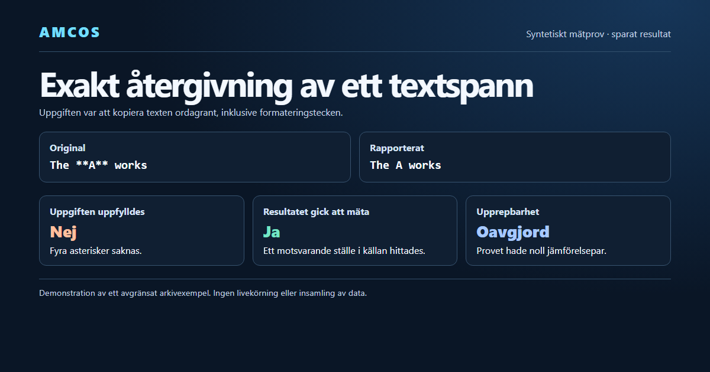

# AMCOS

**Forskningsprototyp med syntetisk demonstration.** Det sparade provet visas fristående från en aktuell Core-databas. Produktionsdrift ligger utanför demonstrationen.

AMCOS utvecklas av Frida och Jimmy för team som behöver kunna följa hur AI bearbetar dokument, koppla ett resultat till rätt källa och se vad som fortfarande är osäkert.

## Ett konkret exempel

I ett sparat syntetiskt prov skulle ett textspann återges exakt. Resultatet gick att matcha mot rätt ställe i källan, men den återgivna texten saknade fyra asterisker. Uppgiften misslyckades, resultatet gick att mäta och upprepbarheten var oavgjord.

[Läs exemplet](demo/synthetic-example.md) · [Öppna demonstrationsfilen lokalt](demo/index.html)

## Vi söker designpartners

Vi vill prata med team som använder AI för dokumentextraktion, källbundna sammanfattningar eller överlämning till en mänsklig granskare. Ett första samtal tar ungefär 20 minuter. Vi visar det sparade provet och undersöker om ett av era arbetsmoment kan återskapas med fiktiva data. [Skriv till Frida via AMCOS-inlägget på LinkedIn](https://www.linkedin.com/feed/update/urn:li:activity:7531429106639523842/). En kort processbeskrivning räcker inför första mötet.

AMCOS är i prototypstadiet. Demonstrationen visar ett arkiverat fall. Intresseanmälan gäller samtal och en eventuell syntetisk pilot.

[Vision](docs/vision.md) · [Arkitektur](docs/architecture.md) · [Evidensprinciper](docs/evidence-principles.md) · [Färdplan](ROADMAP.md) · [Demonstrationens datagräns](DEMO_DATA_POLICY.md)
